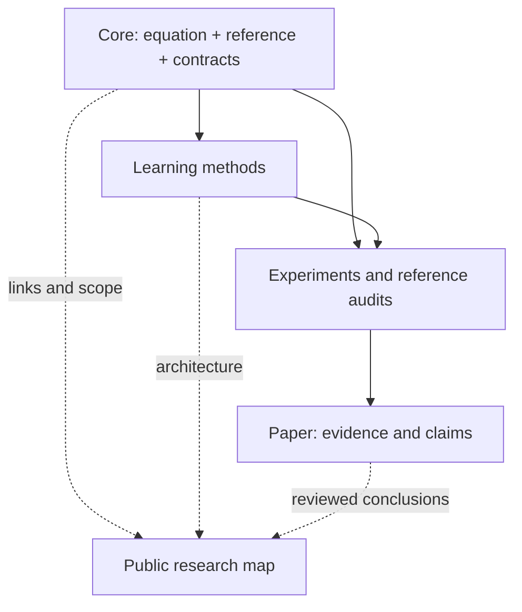

# The Dysthe research family

The [5 November 2026 research record](research-record/2026-11-05/README.md) indexes completed work, the original source revisions and all project chats. The pinned bootstrap manifest and migration narrative below are retained as historical setup instructions.

The public family separates reusable physics, candidate learning methods,
controlled experiments, and the paper. The current repositories are migration
scaffolds; creating branches does not mean their methods are implemented.

| Repository | Owns | Workstream branches |
| --- | --- | --- |
| [dysthe-core](https://github.com/matasvai/dysthe-core) | Equation, reference solver, initial-field families, diagnostics, shared contracts | `codex/reference-migration`, `codex/initial-condition-family` |
| [dysthe-learning](https://github.com/matasvai/dysthe-learning) | FNO baseline, hybrid solver, reduced model, DeepONet, active GP | `codex/fno-baseline`, `codex/hybrid-solver`, `codex/reduced-model`, `codex/deeponet`, `codex/active-learning` |
| [dysthe-experiments](https://github.com/matasvai/dysthe-experiments) | Dataset campaigns, splits, evaluation protocol, run manifests, eventual Slurm entrypoints | `codex/reference-campaign`, `codex/benchmark-suite` |
| [dysthe-paper](https://github.com/matasvai/dysthe-paper) | LaTeX manuscript, PDF figures, compact figure data, claim ledger | `codex/manuscript-outline` |
| [dysthe-research-map](https://github.com/matasvai/dysthe-research-map) | Public explanation, repository directory and pinned workspace manifest | `main` for the deployed site |



The learning package depends on an exact core Git revision. Experiments pin
both packages. The paper consumes promoted evidence; runtime packages do not
depend on the paper or website. `family.json` records an immutable starting
snapshot and the prepared branches. Update dependency pins deliberately after
merging compatible shared changes.

## Set up the workspace

Clone this hub once and create the four sibling clones:

```sh
git clone https://github.com/matasvai/dysthe-research-map.git
cd dysthe-research-map
python3 scripts/workspace.py setup
```

Python 3.10+ and Git are sufficient. A fresh clone gets a local `main` at the
recorded revision, tracking `origin/main`. Existing directories are inspected
and left untouched. A different repository at the expected path stops setup.
No dependencies, models, credentials, or datasets are installed by this command.

Check revisions at any time:

```sh
python3 scripts/workspace.py status
```

## First workstream

Start with the shared reference implementation:

```sh
cd ../dysthe-core
git switch --track origin/codex/reference-migration
```

Use this pattern for another prepared branch. If a local branch already exists,
use `git switch BRANCH_NAME`. Keep shared fixes on main through focused pull
requests, then merge main into active workstreams. Branches are temporary work
areas, not long-lived copies of the solver. Package directories on main will
eventually hold the integrated methods.

## Move over in this order

1. **Core reference:** port the selected water-wave equation and solver from the
   existing work, record upstream revisions/hashes, and compare identical inputs
   before changing numerics. Recheck signs, nonlinear terms and normalization.
2. **Initial-condition family:** establish stable physical group IDs and verify
   initial fields across resolution/domain changes. Define parameter bounds.
3. **Reference campaign:** choose a short, resolved horizon; freeze refinement
   screens and whole-trajectory splits before generating training data.
4. **FNO and hybrid:** establish one common field baseline and one candidate
   improvement. Include early stopping, checkpoint/resume and detailed training
   logs before expensive runs. Other method branches are prepared for later work.
5. **Benchmarks:** test unseen fields, phase/growth errors, physical diagnostics,
   rollout behavior, multiple seeds and matched-accuracy computational cost.
6. **Paper:** promote only evidence with source commits, accessible artifacts,
   hashes and clear limitations. Choose a central claim before selecting a venue.

## Scope and existing work

This family is **water-wave Dysthe only**, governed by [SCOPE.md](SCOPE.md).
The approved baseline is the one-coordinate spatial free-surface-envelope model
of Fedele–Dutykh, with propagation distance xi and retarded time tau. The existing
project's `nonlinear/solver.py`, `kind='dysthe'`, is the reference migration
source. Its files and hashes must be recorded when ported; they have not yet
been copied into this public scaffold. The prior optical PINN is not this solver.

Other physical settings are excluded from active work and publication evidence.
Historical artifacts remain intact with their original identities. No old
cluster job becomes a water-wave job through renaming. New short submission
commands will be provided after water-wave execution and refinement checks pass.
Only the human project owner may directly authorize a future scope change.

Large field arrays and checkpoints stay in durable research storage. Commit
compact manifests, metrics, configuration files and vector figures. A passed
repository check means the scaffold and metadata work; it does not demonstrate
a physically accurate solver, trained predictor or publishable result.
